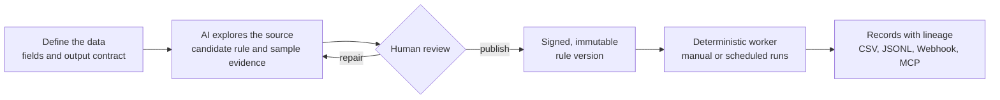

<div align="center">

# Extrio

**Turn websites into data pipelines you can audit.**

AI drafts the extraction rule. A person reviews and publishes it.<br>
The worker runs it deterministically, with no model in the loop.

[Quick start](#quick-start) · [How it works](#how-it-works) · [Documentation](#documentation) · [Website](https://extrio.ouvo.ai) · [中文](README.zh-CN.md)

[](https://github.com/iiwish/extrio/actions/workflows/ci.yml)
[](LICENSE)
[](docs/releases/v1.0-rc.3.md)
[](backend/pyproject.toml)

</div>

Extrio is a self-hosted platform for collecting structured data from public and authorized websites.
Instead of hand-writing scrapers or calling an LLM on every page, you describe the data you need,
let a model propose a rule, and publish it only after reviewing sample evidence. Every record can
be traced back to its source page, the run that collected it, and the exact signed rule version
that produced it.

It is built for data-operations teams that track tender notices, regulatory announcements, and
other public notices: work where "the scraper ran" is not enough, and you need to answer **what
was collected, what was rejected, and why**.


*A published rule in the console (shown in Chinese; the console also supports English). Local
instance with demonstration data. [Take the console walkthrough](docs/showcase.md).*

## How it works



- **AI at authoring time, not at run time.** Models help create and repair rules. Collection runs
  execute frozen rules and never call a model, so the same rule and the same response bytes
  always produce the same result.
- **People own publication.** Only a reviewer or administrator can publish a rule. Published
  versions are immutable and Ed25519-signed; AI repairs come back as new candidates for review.
- **Evidence over success badges.** Runs report page limits, unfetched pages, and quality
  rejections alongside their results. Each item links to its source, run, and rule version, and
  can be exported in a signed evidence bundle.

## Why Extrio

| | Hand-written crawlers<br>(e.g. Scrapy, Crawlee) | LLM extraction per request | **Extrio** |
| --- | --- | --- | --- |
| Who defines extraction | Engineers, in code | A model, on every page | A model drafts; a person publishes |
| Model calls during collection | None | Every page | **None** |
| Change control | Your code review process | Prompt and schema changes | **Reviewed, signed, immutable rule versions** |
| Where each record came from | Build it yourself | Varies by service | **Built in: item, run, rule version** |
| Operations console | Build it yourself | Varies by service | **Self-hosted, with roles and audit records** |

**Extrio is a good fit if you:**

- collect from a known set of list and detail sites (notices, announcements, catalogs), manually
  or on a schedule;
- must explain where every record came from, and want changes to extraction reviewed first;
- want AI to reduce setup work without letting it change production behavior on its own;
- need to self-host, evaluating on SQLite and deploying on PostgreSQL.

**Look elsewhere if you need:** large-scale crawling of arbitrary sites or infinite scroll;
logged-in sources, CAPTCHA solving, or bypassing access controls; one-off "chat with a page"
extraction; or a hosted, multi-tenant service with SSO/MFA and high availability. The console
targets desktop browsers 1024px and wider.

## Quick start

### Docker Compose

Install Git and Docker with the Compose plugin, then run:

```bash
git clone https://github.com/iiwish/extrio.git
cd extrio
docker compose up --build --wait
```

Open **[http://127.0.0.1:8080](http://127.0.0.1:8080)** and create the first administrator
account (passwords need at least 8 characters). The stack runs the console, API, and worker, and
keeps state in a named volume. The first build installs browser dependencies and can take several
minutes.

A local tender source is seeded for evaluation. To generate new rules with AI, add a model provider
under **Settings → Model settings**. Presets cover OpenAI, DeepSeek, Alibaba Cloud Bailian, and a
local Ollama server, and you can add any other OpenAI-compatible service.

Stop the stack without deleting your data:

```bash
docker compose down
```

Do not add `-v` unless you intend to delete the database, keys, and artifacts in the volume. If a
default port is taken, choose others with `EXTRIO_API_PORT` and `EXTRIO_WEB_PORT`.

### From source

Prerequisites: Git, **Python 3.12**, [uv](https://docs.astral.sh/uv/), **Node.js 22**, and the
pnpm version pinned in [web/package.json](web/package.json).

```bash
uv sync --project backend --locked --python 3.12
uv run --project backend python -m playwright install --with-deps --only-shell chromium
pnpm --dir web install --frozen-lockfile
./scripts/dev.sh
```

Open **[http://127.0.0.1:5173](http://127.0.0.1:5173)**. The API listens on port `8000`, with
interactive documentation at `/docs` after login. Stop with `./scripts/stop.sh`. For isolated
instances, set `EXTRIO_INSTANCE_DIR`, `EXTRIO_API_PORT`, and `EXTRIO_WEB_PORT`, and use the same
instance directory when stopping.

### Run a collection without a model key

With the backend dependencies installed:

```bash
uv run --project backend python scripts/benchmark.py --collectors 1 --pages 1
```

This runs a hand-written, signed rule through the real worker against a bundled local source, in
temporary storage. It makes no third-party requests, costs nothing, and does not touch an existing
instance. It is an execution smoke test, not a compatibility or capacity benchmark.

## Features

| Area | What you get |
| --- | --- |
| Sources | Static HTML and JSON, list-to-detail flows, declared pagination, and bounded Playwright rendering for script-built pages. URL-list import with per-URL validation. |
| AI assistance | Rule generation and repair with sample evidence, structured task history, attempt records, and model usage. Works with OpenAI-compatible providers, including local Ollama. Raw prompts and model responses stay out of activity logs. |
| Data quality | Field contracts, type normalization, identity and fingerprint fields, accepted and rejected records with reasons, revisions, and observations. |
| Incremental collection | Checkpoints and controlled time windows for supported date-ordered sources; arbitrary cursors are not supported. |
| Governance | Administrator, engineer, reviewer, and viewer roles; human publication; signed rule attestations; audit records. Independent two-person approval is not enforced. |
| Delivery | CSV and JSONL export, Webhooks with stable delivery IDs and retries, signed evidence bundles, and an MCP server. |
| Operations | Durable jobs, schedules, `/healthz` and `/readyz`, `extrio-doctor` diagnostics, backup and restore, key rotation, and opt-in Prometheus metrics. |
| Storage | SQLite (WAL) for evaluation, PostgreSQL 16 for deployments, and filesystem artifacts. |
| Console | Desktop web console in English and Chinese. |

## MCP server

Extrio gives AI clients governed access through `extrio-mcp`:

| Tool | Purpose |
| --- | --- |
| `list_collectors` | List sources, publication state, schedules, and recent outcomes. |
| `get_collector` | Inspect a source, its frozen fields, recent runs, and delivery sinks. |
| `create_collection` | Create a source and queue AI exploration for human review. |
| `trigger_run` | Run an already-published, integrity-verified rule. |
| `get_run` | Inspect status, counts, stop reason, integrity checks, and checkpoint. |
| `query_items` | Read filtered, cursor-paginated records. |
| `get_item` | Inspect a record's data, decision evidence, observations, and lineage. |

**There is no publication tool.** An agent can request exploration, but a person must publish the
rule before any run can use it.

For trusted local clients, launch from the repository root:

```bash
uv run --project backend extrio-mcp
```

For Streamable HTTP, set a strong secret in `EXTRIO_MCP_TOKEN`, then launch:

```bash
uv run --project backend extrio-mcp --transport http --host 127.0.0.1 --port 8818
```

The endpoint is `http://127.0.0.1:8818/mcp` and requires `Authorization: Bearer <token>`. MCP must
share the **same database, artifact directory, and signing and encryption keys** as the API and
worker. The HTTP token grants access to all seven tools; it is not a browser user's role-scoped
session, so use TLS for remote access. See the
[API and MCP client guidance](docs/self-hosted-operations.md#api-与-mcp-客户端).

## Project status

**Current release: [v1.0.0-rc.3](docs/releases/v1.0-rc.3.md)** (prerelease), published from
commit `4f3929202d65601ced4ace3656eb726c64287459`.

- **Validated:** single-organization self-hosting on SQLite and PostgreSQL 16, with signed
  `linux/amd64` and `linux/arm64` images that carry provenance and SBOM attestations.
- **Known issue:** scans after publication flagged HIGH advisories in `filelock 3.32.4` and
  `pypdf 6.21.1`, which the RC3 images include. The fix moves to `filelock 4.2.1` and
  `pypdf 6.21.2` and will ship in the next candidate. Do not treat RC3 as cleared for production.
- **Not yet stable:** `v1.0.0` awaits product and technical acceptance; see the
  [stable handoff](docs/releases/v1.0.0.md).
- **Not claimed:** compatibility with arbitrary websites, production-scale capacity, or an SLA. A
  site listed in the bundled source catalog is not a compatibility claim.

See the [roadmap](ROADMAP.md) for direction and the [changelog](CHANGELOG.md) for release history.

## Self-hosting safely

- Keep the API and worker off the public internet. Route console traffic through the bundled web
  proxy and a TLS reverse proxy you control.
- Production defaults enable secure cookies and disable anonymous HTTP sources, demo seeding,
  automatic migration, and metrics. The local Compose profile turns its development exceptions on
  explicitly.
- Protect credentials, signing keys, persistent volumes, and outbound network access. Never reuse
  development keys in production.
- Back up the database, artifacts, and keys together, and test a restore before upgrading.
  Evidence bundles are not backups.
- `/metrics` is off by default and unauthenticated when enabled, so restrict it to trusted
  monitoring. `/healthz` reports API liveness; `/readyz` also checks the worker and key
  consistency.
- Collect only from public or explicitly authorized sources, and respect their access conditions.

Read [SECURITY.md](SECURITY.md) and the [operations guide](docs/self-hosted-operations.md) before
handling sensitive data or exposing an instance beyond localhost.

## Documentation

Several detailed design and operations documents are currently written in Chinese; API contracts
and code identifiers are shared across languages. English translations are welcome.

| Start here | What you will find |
| --- | --- |
| [Console walkthrough](docs/showcase.md) | A three-minute product tour with screenshots. |
| [Rules guide](docs/rules-guide.md) | How extraction rules are structured, executed, and reviewed. |
| [Operations guide](docs/self-hosted-operations.md) | Configuration, PostgreSQL, upgrades, diagnostics, backup and restore, keys. |
| [API contract](docs/contracts/api-contract.md) · [OpenAPI](docs/contracts/openapi.yaml) | Integration contracts, schemas, and examples. |
| [Backend architecture](docs/backend-vertical-slice.md) · [Architecture decisions](docs/architecture/) | Runtime responsibilities and design decisions. |
| [Product definition](docs/SSOT.md) · [Product contract](docs/product-contract.md) | Goals, scope, and behavioral boundaries. |
| [RC3 release record](docs/releases/v1.0-rc.3.md) · [Changelog](CHANGELOG.md) | What shipped, how it was verified, and known limits. |

## Contributing

Contributions are welcome, especially:

- **source fixtures and compatibility reports** for sites you are authorized to collect from;
- **extraction templates** for common notice and announcement layouts;
- **documentation and translations**, including English versions of the Chinese design docs;
- **focused fixes** with tests.

[CONTRIBUTING.md](CONTRIBUTING.md) covers development setup, the repository layout, and the checks
to run before a pull request. Open an [issue](https://github.com/iiwish/extrio/issues) before
starting a large behavioral or contract change, and use
[Discussions](https://github.com/iiwish/extrio/discussions) for questions and ideas. Report
vulnerabilities **privately** as described in [SECURITY.md](SECURITY.md).

## License

Extrio is licensed under the [Apache License 2.0](LICENSE). See [NOTICE](NOTICE) for attribution
notices.
