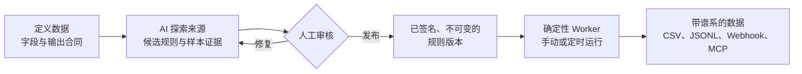

<div align="center">

# Extrio

**把网站变成可审计的数据管线。**

AI 起草提取规则，人工审核后发布，<br>
Worker 确定性执行，采集过程中不调用任何模型。

[快速开始](#快速开始) · [工作原理](#工作原理) · [文档导航](#文档导航) · [官网](https://extrio.ouvo.ai) · [English](README.md)

[](https://github.com/iiwish/extrio/actions/workflows/ci.yml)
[](LICENSE)
[](docs/releases/v1.0-rc.3.md)
[](backend/pyproject.toml)

</div>

Extrio 是一个**自托管的网页数据采集平台**，从公开或已获授权的网站采集结构化数据。你不需要手写爬虫，也不需要在每个页面上调用大模型：先描述需要的数据，让模型提出候选规则，查看样本证据后再决定是否发布。每一条记录都能追溯到来源页面、采集它的那次运行，以及生成它的那个已签名规则版本。

Extrio 面向跟踪招投标公告、监管信息和其他公共公告的数据运营团队。在这类工作中，"爬虫跑完了"远远不够，团队需要回答：**采集到了什么、哪些被拒绝了、原因是什么。**


*控制台中一条已发布的规则。截图来自使用演示数据的本地实例。[查看控制台导览](docs/showcase.md)。*

## 工作原理



- **AI 只用于编写规则，不参与运行。** 模型帮助生成和修复规则；采集运行只执行冻结的规则，从不调用模型。同一规则加上同样的响应字节，永远得到同样的结果。
- **发布权在人手里。** 只有审核员或管理员可以发布规则。已发布版本不可修改，并带有 Ed25519 签名；AI 修复会作为新的候选重新进入审核。
- **用证据说话，而不只是一个成功标记。** 运行结果会同时列出页数上限、未获取的页面和质量拒绝。每条数据都关联到来源、运行和规则版本，并可导出为签名证据包。

## 为什么选择 Extrio

| | 手写爬虫<br>（如 Scrapy、Crawlee） | 每次请求调用 LLM 提取 | **Extrio** |
| --- | --- | --- | --- |
| 谁来定义提取逻辑 | 工程师写代码 | 模型在每个页面上现场判断 | 模型起草，人工发布 |
| 采集时的模型调用 | 无 | 每个页面都要调用 | **无** |
| 变更管控 | 依赖团队的代码评审流程 | 修改提示词或 Schema | **经过审核、签名且不可变的规则版本** |
| 每条记录的来历 | 需要自行实现 | 取决于具体服务 | **内置：数据、运行、规则版本** |
| 运维控制台 | 需要自行搭建 | 取决于具体服务 | **自托管，带角色与审计记录** |

**适合以下场景：**

- 从一批已知的列表/详情类网站（公告、通知、目录）手动或定时采集；
- 必须说清楚每条记录从哪里来，并希望提取逻辑的变更先经过审核；
- 希望借助 AI 减少配置工作，但不允许它自行改变生产行为；
- 需要自托管：用 SQLite 评估，用 PostgreSQL 部署。

**以下需求请考虑其他方案：** 大规模抓取任意网站或无限滚动页面；需要登录的来源、验证码识别或绕过访问控制；一次性的"和网页对话"式提取；需要 SSO/MFA、高可用的多租户托管服务。控制台面向 1024px 及以上宽度的桌面浏览器。

## 快速开始

### Docker Compose

安装 Git 和带 Compose 插件的 Docker，然后运行：

```bash
git clone https://github.com/iiwish/extrio.git
cd extrio
docker compose up --build --wait
```

打开 **[http://127.0.0.1:8080](http://127.0.0.1:8080)**，创建首个管理员账号（密码至少 8 位）。服务包含控制台、API 和 Worker，状态保存在具名持久卷中。首次构建会安装浏览器依赖，可能需要几分钟。

实例会预置一个本地招投标示例来源，便于评估。要用 AI 生成新规则，请在**设置 → 模型设置**中添加模型供应商。内置预设包括 OpenAI、DeepSeek、阿里云百炼和本地 Ollama，也可以添加任何兼容 OpenAI 接口的服务。

停止服务并保留数据：

```bash
docker compose down
```

除非确实要删除持久卷中的数据库、密钥和证据文件，否则不要加 `-v`。默认端口被占用时，可以通过 `EXTRIO_API_PORT` 和 `EXTRIO_WEB_PORT` 指定其他端口。

### 从源码运行

前置依赖：Git、**Python 3.12**、[uv](https://docs.astral.sh/uv/)、**Node.js 22**，以及 [web/package.json](web/package.json) 中锁定版本的 pnpm。

```bash
uv sync --project backend --locked --python 3.12
uv run --project backend python -m playwright install --with-deps --only-shell chromium
pnpm --dir web install --frozen-lockfile
./scripts/dev.sh
```

打开 **[http://127.0.0.1:5173](http://127.0.0.1:5173)**。API 使用 `8000` 端口，登录后可在 `/docs` 查看交互式 API 文档。用 `./scripts/stop.sh` 停止。需要隔离实例时，设置 `EXTRIO_INSTANCE_DIR`、`EXTRIO_API_PORT` 和 `EXTRIO_WEB_PORT`，停止时使用相同的实例目录。

### 不配置模型密钥，先跑一次采集

安装后端依赖后执行：

```bash
uv run --project backend python scripts/benchmark.py --collectors 1 --pages 1
```

该命令用一条手写的签名规则，通过真实 Worker 采集内置的本地来源，数据写入临时目录。它不访问第三方网站、不产生费用，也不影响已有实例。这是执行链路的冒烟测试，不是兼容性或容量基准。

## 功能

| 领域 | 能力 |
| --- | --- |
| 来源 | 静态 HTML 和 JSON、列表到详情的采集流程、声明式分页，以及用 Playwright 有限度地渲染脚本生成的页面。支持导入 URL 列表并逐条校验。 |
| AI 辅助 | 带样本证据的规则生成与修复、结构化任务历史、尝试记录和模型用量。支持兼容 OpenAI 接口的供应商，包括本地 Ollama。活动日志不保存原始提示词和模型响应。 |
| 数据质量 | 字段合同、类型规范化、身份与指纹字段、带原因的接收/拒绝记录、修订和观测历史。 |
| 增量采集 | 针对受支持的按日期排序来源，提供检查点和受控时间窗口；不支持任意游标。 |
| 治理 | 管理员、工程师、审核员、只读用户四种角色；人工发布、签名规则证明和审计记录。暂不强制独立双人审批。 |
| 数据交付 | CSV 和 JSONL 导出、带稳定投递 ID 和重试的 Webhook、签名证据包，以及 MCP 服务。 |
| 运维 | 持久化任务、定时计划、`/healthz` 与 `/readyz`、`extrio-doctor` 诊断、备份恢复、密钥轮换，以及可选开启的 Prometheus 指标。 |
| 存储 | SQLite（WAL）用于评估，PostgreSQL 16 用于部署，证据文件存放在文件系统中。 |
| 控制台 | 中英文双语的桌面 Web 控制台。 |

## MCP 服务

Extrio 通过 `extrio-mcp` 为 AI 客户端提供受治理的访问：

| 工具 | 用途 |
| --- | --- |
| `list_collectors` | 查看来源、发布状态、调度计划和最近运行结果。 |
| `get_collector` | 查看来源详情、冻结字段、最近运行和投递目标。 |
| `create_collection` | 创建来源，并提交 AI 探索等待人工审核。 |
| `trigger_run` | 运行已发布且完整性校验通过的规则。 |
| `get_run` | 查看状态、数量、停止原因、完整性检查和检查点。 |
| `query_items` | 按条件筛选，以游标分页读取数据。 |
| `get_item` | 查看记录内容、判定证据、观测历史和完整谱系。 |

**MCP 不提供发布工具。** Agent 可以请求探索，但规则必须由人发布后才能用于运行。

面向可信的本地客户端，在仓库根目录启动：

```bash
uv run --project backend extrio-mcp
```

使用 Streamable HTTP 时，先在 `EXTRIO_MCP_TOKEN` 中设置高强度密钥，再启动：

```bash
uv run --project backend extrio-mcp --transport http --host 127.0.0.1 --port 8818
```

端点为 `http://127.0.0.1:8818/mcp`，请求须携带 `Authorization: Bearer <token>`。MCP 必须与 API、Worker 使用**同一数据库、证据目录、签名密钥和凭据加密密钥**。HTTP token 可以访问全部七个工具，并不受浏览器用户角色约束，因此远程访问必须使用 TLS。详见 [API 与 MCP 客户端指南](docs/self-hosted-operations.md#api-与-mcp-客户端)。

## 项目状态

**当前版本：[v1.0.0-rc.3](docs/releases/v1.0-rc.3.md)**（预发布），源提交 `4f3929202d65601ced4ace3656eb726c64287459`。

- **已验证：** 单组织自托管，支持 SQLite 和 PostgreSQL 16；`linux/amd64` 与 `linux/arm64` 镜像均已签名，并附带 provenance 和 SBOM 证明。
- **已知问题：** 发布后的扫描在 `filelock 3.32.4` 和 `pypdf 6.21.1` 中发现 HIGH 级漏洞公告，RC3 镜像包含这两个版本。修复会将它们升级到 `filelock 4.2.1` 和 `pypdf 6.21.2`，并随下一个候选版本发布。请勿将 RC3 视为可用于生产。
- **尚未稳定：** 正式版 `v1.0.0` 仍在等待产品与技术验收，见[稳定版交接记录](docs/releases/v1.0.0.md)。
- **不做承诺：** 不承诺兼容任意网站、生产级处理规模或 SLA。内置来源目录中列出的网站不代表已经适配。

发展方向见[路线图](ROADMAP.md)，版本历史见[更新日志](CHANGELOG.md)。

## 安全自托管

- 不要把 API 和 Worker 直接暴露到公网。控制台流量应经过内置 Web 代理和你自己管理的 TLS 反向代理。
- 生产默认值启用 Secure Cookie，并关闭匿名 HTTP 来源、演示数据、自动迁移和指标。本地 Compose 配置会显式开启所需的开发例外。
- 保护凭据、签名密钥、持久卷和出站网络访问。生产环境不得复用开发密钥。
- 数据库、证据文件和密钥要一起备份，升级前先验证恢复流程。证据包不能当作备份。
- `/metrics` 默认关闭，开启后不要求认证，应限制在可信监控网络内。`/healthz` 只说明 API 存活，`/readyz` 还会检查 Worker 和密钥一致性。
- 只采集公开或明确授权的来源，并遵守其访问条件。

处理敏感数据或将实例开放到本机之外之前，请阅读[安全政策](SECURITY.md)和[运维指南](docs/self-hosted-operations.md)。

## 文档导航

部分详细设计与运维文档目前只有中文版；API 合同和代码标识在两种语言中共用。欢迎贡献英文翻译。

| 入口 | 内容 |
| --- | --- |
| [控制台导览](docs/showcase.md) | 三分钟产品演示流程与截图。 |
| [规则指南](docs/rules-guide.md) | 提取规则的结构、执行语义和审核要点。 |
| [运维指南](docs/self-hosted-operations.md) | 配置、PostgreSQL、升级、诊断、备份恢复与密钥管理。 |
| [API 合同](docs/contracts/api-contract.md) · [OpenAPI](docs/contracts/openapi.yaml) | 集成合同、Schema 与示例。 |
| [后端架构](docs/backend-vertical-slice.md) · [架构决策](docs/architecture/) | 运行时职责与设计决策。 |
| [产品定义](docs/SSOT.md) · [产品合同](docs/product-contract.md) | 产品目标、范围与行为边界。 |
| [RC3 发行记录](docs/releases/v1.0-rc.3.md) · [更新日志](CHANGELOG.md) | 发布内容、验证方式与已知限制。 |

## 参与贡献

欢迎各种形式的贡献，尤其是：

- 你有权采集的网站的**来源样本与兼容性报告**；
- 常见公告、通知页面结构的**提取模板**；
- **文档与翻译**，包括中文设计文档的英文版；
- 附带测试的**聚焦修复**。

[贡献指南](CONTRIBUTING.md)介绍了开发环境、仓库结构以及提交 PR 前需要运行的检查。较大的行为或合同变更，请先开 [Issue](https://github.com/iiwish/extrio/issues) 讨论；使用问题和想法可以发到 [Discussions](https://github.com/iiwish/extrio/discussions)。安全漏洞请按 [SECURITY.md](SECURITY.md) 的流程**私下报告**。

## 许可证

Extrio 使用 [Apache License 2.0](LICENSE) 许可证。署名声明见 [NOTICE](NOTICE)。
